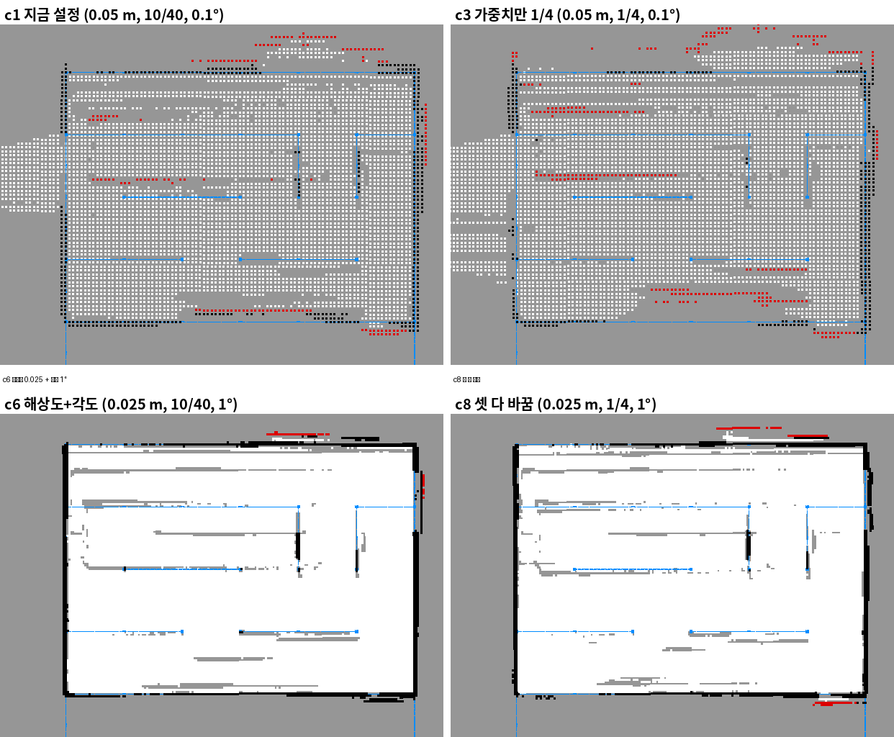

## 미로 SLAM 시뮬레이션 실행
```shell
# Gazebo
source ~/git/ros_test/waffle-lyrical-slam/install/setup.bash
source ~/git/ros_test/waffle-lyrical-slam/gazebo_install/setup.bash
ros2 launch ~/git/lv2_next_module/sim/gazebo_maze_waffle_pi.launch.py gui:=true
# Maze map Cartographer
source ~/git/ros_test/waffle-lyrical-slam/install/setup.bash
ros2 launch waffle_slam_course cartographer.launch.py
# RViz
rviz2 --ros-args -p use_sim_time:=true
# Keyboard
ros2 run teleop_twist_keyboard teleop_twist_keyboard --ros-args -p stamped:=true -p frame_id:=base_footprint -p use_sim_time:=true -p speed:=0.1 -p turn:=0.2
# /scan, /odom, /tf, /tf_static, /clock, /imu 토픽 ros2 bag 녹화
ros2 bag record --disable-keyboard-controls -o ~/git/lv2_next_module/results/cartographer_ab/bag_$(date +%Y%m%d_%H%M) --topics /scan /odom /tf /tf_static /clock /imu
# Map Save
source ~/git/ros_test/waffle-lyrical-slam/install/setup.bash
ros2 run nav2_map_server map_saver_cli -f ~/git/lv2_next_module/maps/waffle_pi_maze --ros-args -p use_sim_time:=true
ros2 service call /write_state cartographer_ros_msgs/srv/WriteState "{filename: '/home/pa4/git/lv2_next_module/maps/waffle_pi_maze.pbstream', include_unfinished_submaps: true}"
```

# Cartographer 파라미터

## 설정 구조
- ROS launch: 파일 경로, 토픽 remap, `use_sim_time`
- `options`: 센서 입력, 프레임, 발행 주기
- `TRAJECTORY_BUILDER`: 로컬 정합, submap 구성 (Local SLAM)
- `POSE_GRAPH`: 루프 폐합 제약, 전역 최적화 (Global SLAM)
- Lua는 `include "map_builder.lua"` 등으로 기본값을 읽은 뒤 실습 파일에서 대입해 덮어씀
- Lua는 `ros2 param set`으로 바꾸는 동적 파라미터가 아님 → 수정 후 빌드·Cartographer 재시작해야 반영

```shell
# src/waffle_slam_course/config/waffle_2d.lua 수정 후
colcon build --packages-select waffle_slam_course --symlink-install
source install/setup.bash
ros2 launch waffle_slam_course cartographer.launch.py
```

## 센서 입력
- Cartographer가 받을 수 있는 입력: LaserScan, MultiEchoLaserScan, PointCloud2, odometry, IMU, GPS(nav_sat), landmark
- Waffle 실습: LaserScan 1개 + 바퀴 odom 사용, IMU·GPS·landmark 사용 안 함
  - `use_odometry=true`, `use_imu_data=false`, `num_laser_scans=1`
- `use_*`를 true로 켜면 해당 데이터와 TF가 실제로 들어와야 함 → 안 들어오면 데이터를 기다리며 진행 안 됨
- 센서가 끊기거나 축·TF가 틀린 문제는 알고리즘 파라미터로 보정 불가 → 입력·시간·TF부터 확인

### LiDAR를 여러 개 쓸 때
- `num_laser_scans=1`이면 토픽 `scan`, 2개 이상이면 `scan_1`, `scan_2` … 처럼 개별 토픽으로 구독
- 방법 1: 각 LiDAR 토픽을 `scan_1`, `scan_2`로 remap해서 따로 입력
- 방법 2: 두 스캔을 하나의 기준 프레임으로 합친 뒤 단일 토픽으로 다시 publish
- 어느 방법이든 각 LiDAR의 장착 위치 TF가 정확해야 두 스캔이 같은 벽으로 겹침

### TF 역할 분담
- Gazebo(Sim): odom → base_footprint 연속 이동 발행
- Cartographer: map → odom 보정 발행
- `tracking_frame=base_footprint`, `published_frame=odom`
- `provide_odom_frame=false` → Cartographer가 odom TF를 따로 만들지 않음, 같은 TF를 두 노드가 발행하는 충돌 방지

## 발행 주기
| 설정 | 실습값 | 의미 |
|---|---|---|
| `pose_publish_period_sec` | 0.005s | 자세 TF 발행 200Hz |
| `trajectory_publish_period_sec` | 0.03s | 경로 시각화 마커 약 33Hz |
| `submap_publish_period_sec` | 0.3s | submap 목록 약 3.3Hz |
| grid `publish_period_sec` | 1.0s | `/map` 약 1Hz |

- 발행 타이머일 뿐 센서 처리율이나 정합 주기가 아님
- 짧게 하면 RViz 갱신은 빨라지지만 통신량·CPU 부하 증가

## Motion filter
- 마지막으로 채택한 스캔 이후 시간·거리·각도 변화가 **모두** 기준 이하면 이번 스캔 삽입 생략
- 하나라도 기준을 넘으면 삽입
- 실습값: 5s, 0.2m, 0.1°(약 0.0017rad)
- 제자리에 서 있을 때 같은 스캔이 계속 쌓여 노드·계산량이 늘어나는 것을 막는 판정
- SLAM 계산 전체나 자세 발행을 끄는 설정은 아님
- Lua의 각도 단위는 rad → 도 값을 그대로 넣지 않도록 주의

## Correlative 탐색
- 운동 예측(odom)으로 이번 스캔의 초기 자세를 만듦
- `use_online_correlative_scan_matching=true`면 초기 자세 주변 후보를 전부 점수로 비교해 가장 좋은 자세 선택
  - 탐색 범위: `linear_search_window=0.1m`, `angular_search_window=20°`
- 고른 자세를 시작값으로 Ceres 최적화가 최종 자세를 다듬음
  - 가중치: `occupied_space_weight`(지도와 맞추기) vs `translation_weight`·`rotation_weight`(초기 자세 유지)
- 후보를 전부 보는 방식이라 범위를 넓히면 계산량 증가, odom이 나쁠 때 도움
- 로컬 탐색(0.1m)과 루프 폐합 탐색(7m)은 서로 다른 설정

## 점유 확률 갱신
- `hit_probability=0.55`: 레이저 끝점 셀에 점유 증거 누적
- `miss_probability=0.49`: 레이저가 지나간 셀에 빈 공간 증거 누적
- 0.5가 중립, 증거를 로그 오즈로 더함
  - hit 한 번(+0.20)이 miss 약 5번(−0.04 × 5)과 맞먹음
  - 벽은 가끔 레이저가 통과해도 쉽게 지워지지 않고, 지나가는 사람 같은 일시적 장애물은 여러 번 관측되며 천천히 지워짐
- 해상도는 두 곳: submap 내부(0.05m)와 `/map` 출력(0.05m)
  - 출력만 0.025m로 줄여도 내부 0.05m에서 잃은 구조는 복원 안 됨

## 건드리지 않는 파라미터
- 루프 폐합·전역 최적화 주기(`optimize_every_n_nodes=90`), motion filter, odometry 가중치(1e5)
- 서로 맞물려 있어 하나만 바꿔도 결과 변화의 원인을 분리하기 어려움
- 잘못 바꾸면 틀린 루프를 강하게 당기거나 odom을 무시해 지도가 찌그러질 수 있음
- 바꿀 때는 같은 rosbag으로 한 항목씩만 바꿔 비교

## CPU 지연 점검
- Cartographer는 C++ → 백그라운드 스레드(`num_background_threads=4`)가 실제로 여러 코어에서 병렬 실행
- 같은 처리를 Python으로 작성하면 GIL 때문에 한 번에 한 스레드만 Python 코드 실행
  - 스레드를 늘려도 CPU 연산이 병렬로 돌지 않고 스레드끼리 GIL을 두고 경쟁
  - 오히려 전환 비용만 늘어 지연 증가 → 스캔 처리가 입력 주기를 못 따라가 밀림
  - 그래서 Python으로 작성할 때는 CPU 지연 점검 필수
- C++이라도 스레드를 코어 수 이상으로 늘리면 CPU 경쟁으로 지연 증가
- 스레드를 늘리기 전에 입력률·스캔 수·점 수·처리 지연부터 기록
  - local 지연: voxel 필터, 누적 수, 온라인 탐색, Ceres 반복 수 비교
  - global 지연: sampling, 탐색 범위, 최적화 주기, 백그라운드 스레드 수 비교

## pbstream 고정 지도 위치 추정
- 저장한 pbstream을 `load_state_filename`으로 읽고 `load_frozen_state=true`로 기존 지도를 고정한 채 위치만 추정
- PGM/YAML(점유 격자)과 pbstream(SLAM 상태)은 다른 파일
- 이번 실습에서는 따로 건드릴 필요 없음

# Cartographer 파라미터 비교 실험

> 모의 시험: Gazebo + TurtleBot3 Waffle Pi SDF + Twin Closed Maze B (실물 아님)
> 미로·Gazebo 월드: waffle-lyrical-slam (SeongminJaden, Apache-2.0) / 로봇 모델: ROBOTIS turtlebot3_simulations의 turtlebot3_waffle_pi SDF

## 목적과 방법
- 목적: Cartographer 2D 지도 품질에 영향을 주는 값 비교
- Gazebo에서 한 번 주행하며 bag 녹화 (`/scan`, `/odom`, `/tf`, `/tf_static`, `/clock`, `/imu`, 1308s)
  - 키보드 조종, 0.1m/s, 회전 0.17~0.20rad/s
- 같은 bag을 설정 8가지(3변수 × A/B)로 `cartographer_offline_node`에 넣어 지도 생성
- 같은 입력으로 설정만 바꿔 비교 → 주행마다 달라지는 경로·센서 잡음 차이 제거

| 변수 | A (기존) | B | 의미 |
|---|---|---|---|
| `submaps.grid_options_2d.resolution` | 0.05m | 0.025m | 지도 칸 크기 |
| `ceres_scan_matcher.translation_weight` / `rotation_weight` | 10 / 40 | 1 / 4 | 오도메트리 예측을 붙잡는 고무줄 세기 |
| `motion_filter.max_angle_radians` | 0.1° | 1° | 몇 도 돌아야 스캔을 지도에 넣을지 (스캔 속도는 그대로) |

## 평가 지표
- 정답 벽: 미로 STL을 LiDAR 높이(0.131m)에서 자른 단면
- 유령 벽 비율: 지도의 벽 칸 중 정답에서 10cm보다 먼 칸의 비율 (낮을수록 좋음)
- 벽 위치 오차: 지도 벽 칸에서 정답 벽까지 평균 거리 (낮을수록 좋음)
- 벽 채움률: 정답 벽 중 지도에 그려진 비율 (높을수록 좋음)
- CPU 시간

## 결과 (중앙값)
| 설정 | 해상도 / 가중치 / 각도 | 유령 벽 | 오차 [cm] | 채움률 | CPU [s] |
|---|---|---|---|---|---|
| c1 (기존) | 0.05 / 10-40 / 0.1° | 0.269 | 8.07 | 0.428 | 290 |
| c2 각도만 | 0.05 / 10-40 / 1° | 0.142 | 4.96 | 0.490 | 263 |
| c3 가중치만 (채움률 탈락) | 0.05 / 1-4 / 0.1° | 0.452 | 15.00 | 0.289 | 320 |
| c5 해상도만 | 0.025 / 10-40 / 0.1° | 0.123 | 4.65 | 0.543 | 471 |
| **c6 해상도+각도** | 0.025 / 10-40 / 1° | **0.035** | **2.28** | 0.546 | 384 |
| c8 셋 다 | 0.025 / 1-4 / 1° | 0.066 | 2.60 | 0.525 | 386 |

### 변수별 효과 (그 변수만 다른 네 쌍의 B−A 평균)
| 변수 | 유령 벽 | 오차 [cm] | CPU [s] |
|---|---|---|---|
| 각도 0.1° → 1° | −0.192 | −5.2 | −83 |
| 해상도 0.05 → 0.025m | −0.118 | −3.9 | +163 (약 +56%) |
| 가중치 10/40 → 1/4 | +0.064 | +2.3 | 나빠짐 |



## 결론
- **회전 삽입 각도 1°가 가장 효과 크고 계산도 줄어듦**
  - 1° ≈ 0.0175rad, 회전 0.2rad/s·스캔 10Hz면 스캔 한 번에 약 0.02rad(1.15°) 회전 → 회전 중 스캔은 거의 다 들어감
  - 줄어드는 것은 거의 직진·정지할 때 같은 장면이 반복해서 쌓이는 삽입 → 유령 벽 감소
  - 수업에서는 motion filter를 건드리지 말라고 했지만, 이 bag에서는 가장 큰 개선 요인이었음
- **해상도 0.025m는 벽 위치가 더 정확하지만 CPU 약 56% 증가**
  - 로봇 컴퓨터(Jetson)에서 부담되면 0.05m로 되돌림
- **"LiDAR를 더 믿으면(가중치↓) 좋아진다"는 가설은 이 bag에서 틀림**
  - 긴 직선 통로처럼 스캔만으로 앞뒤 위치를 못 정하는 곳에서 손해를 봤을 가능성 (확인 안 함)
  - 37강의 긴 복도 문제와 같은 원리: 스캔 정보가 없는 방향은 odom이 붙잡아 줘야 함
- 채택: **c6** (해상도 0.025m, 가중치 10/40 유지, 각도 1°)

### 한계
- bag 하나, 주행 한 번
- 수동 운전 중 벽 충돌, 일부러 넣은 막힌 구간(약 5초) 때문에 바퀴 오도메트리가 크게 틀어진 주행
- Gazebo의 실제 로봇 위치(ground truth)는 녹화 안 함

## 과정에서 배운 점
- 오프라인 처리(`cartographer_offline_node`)는 결정적 → 같은 bag·설정이면 지도와 pbstream이 바이트 단위로 같음 (md5 일치)
  - 그래서 반복은 1번이면 충분. 실시간 재생은 타이밍에 따라 다를 수 있음
- 오프라인 처리는 bag 끝에 전체 최적화(`RunFinalOptimization`)를 한 번 더 함
  - 루프 폐합 주기(`optimize_every_n_nodes`)의 효과는 최종 지도로는 보기 어려움 → 실시간 재생으로 따로 비교해야 함
- `cartographer_pbstream_to_ros_map`의 PGM은 회색조(모르는 칸 = 128)
  - `map_server`와 같은 확률 기준(점유 > 0.65, 빈칸 < 0.196)으로 읽어야 함
- 정답을 잘못 잡으면 평가 자체가 틀림
  - 처음엔 미로 `model.sdf`의 충돌 박스를 정답으로 씀 → 가로 판넬·기둥만 있고 세로 판넬이 없음
  - 지도에 제대로 그려진 세로 벽이 유령 벽으로 세어짐 → LiDAR가 실제로 보는 메시(STL) 단면으로 정답 교체
- 지도와 정답 정렬 범위를 ±0.10m·±2°에서 ±0.30m·±5°로 넓힘 (설정과 무관하게 y 방향 약 0.1m 어긋남)
