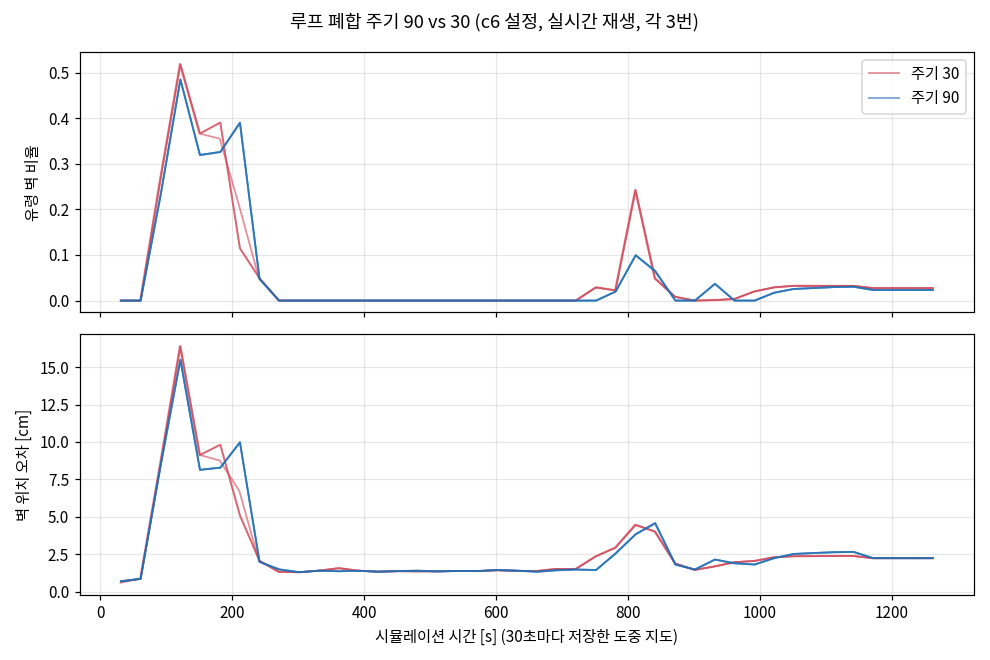

# Cartographer 루프 폐합 주기 비교 실험

> 모의 시험: Gazebo + TurtleBot3 Waffle Pi SDF + Twin Closed Maze B (실물 아님)
> 실험일 2026-10-15, 정리일 2026-10-19. [261014](../261014/ROS2.md)의 파라미터 비교 실험에 이어지는 실험
> 미로·Gazebo 월드: waffle-lyrical-slam (SeongminJaden, Apache-2.0) / 로봇 모델: ROBOTIS turtlebot3_simulations의 turtlebot3_waffle_pi SDF

## 목적과 방법
- 목적: 루프 폐합 주기 `POSE_GRAPH.optimize_every_n_nodes`가 지도 품질과 CPU에 주는 영향 확인
- 기준 설정: 261014 실험에서 채택한 **c6** (해상도 0.025m, ceres 가중치 10/40, 회전 삽입 각도 1°)
- 입력: 261014와 같은 bag (1308s)

| 변수 | A (기본값) | B | 의미 |
|---|---|---|---|
| `POSE_GRAPH.optimize_every_n_nodes` | 90 | 30 | 노드가 몇 개 쌓일 때마다 전체 위치를 다시 계산할지 |

- 오프라인 처리로는 비교 불가
  - `cartographer_offline_node`는 bag 끝에 전체 최적화를 한 번 더 함 → 주기와 관계없이 최종 지도가 비슷해짐
  - 주기가 바꾸는 것은 **주행 도중의 지도**
- 그래서 bag을 실제 시간(1배)으로 재생하며 `cartographer_node` 실행
  - 시뮬레이션 시간 30초마다 `/map` 저장 → 실행 한 번에 도중 지도 42장
  - 설정마다 3번 실행
- 평가: 도중 지도마다 정답 벽(미로 STL 단면)과 비교 → 실행마다 시간 평균 → 3번의 중앙값

## 노드와 루프 폐합 주기
- 주기는 시간이 아니라 **지도에 넣은 스캔(노드) 수**로 셈
- 노드가 생기는 조건 (motion filter, 셋 중 하나를 넘으면)
  - 0.2m 이동 / 5초 경과 / 지정 각도(c6는 1°) 회전
- 직진 0.1m/s → 약 2초에 노드 1개
- 회전 0.2rad/s → 스캔 한 번(0.1s)에 약 1.15° 회전 → 거의 매 스캔(초당 약 10개)
- 90° 한 번 돌면 노드 약 79개 → 주기 90이면 대략 "큰 회전 한두 번마다" 한 번 최적화
- 루프 폐합은 출발점에 왔을 때만이 아니라 주행 내내 뒤에서 후보를 찾고, 주기마다 모아서 반영함
  - 출발점에서 크게 바로잡히는 것은 그때 쌓인 오차가 커서 눈에 잘 띄기 때문

## 결과 (3번 실행의 중앙값)
| 주기 | 도중 유령 벽 (시간 평균) | 도중 오차 [cm] | 마지막 유령 벽 | CPU [s] |
|---|---|---|---|---|
| **90 (기본값)** | **0.053** | 2.84 | **0.023** | **278** |
| 30 | 0.056 | **2.82** | 0.028 | 292 |

- 설정 적용 확인: Cartographer 로그의 최적화 기록이 주기 90에서 47번, 30에서 134번 (약 2.9배)
- 3번 실행끼리 결과가 거의 같음 (도중 유령 벽 평균: 90은 0.0534~0.0535, 30은 0.0560~0.0573)



- 두 주기 모두 시뮬레이션 시간 약 100~250초에 유령 벽이 크게 늘었다가(최대 약 0.49~0.52) 270초 무렵 0으로 내려감
- 약 810초에 다시 올라감 (최대: 주기 30은 0.24, 90은 0.10)
- 끝에서는 둘 다 약 0.025

## 결론
- **주기 30으로 3배 자주 최적화해도 지도 품질은 사실상 같고, CPU만 약 5% 늘어남**
- "자주 최적화하면 주행 도중 유령 벽이 줄어든다"는 가설은 이 bag에서 맞지 않음
- 채택: **주기 90 유지** (기본값). 로봇 컴퓨터(Jetson)에서는 CPU를 아끼는 쪽이 유리

### 한계
- bag 하나, 주행 한 번 (261014와 같은 bag, 바퀴 오도메트리가 크게 틀어진 주행)
- Gazebo의 실제 로봇 위치를 녹화하지 않아 유령 벽이 늘어난 구간에 무슨 일이 있었는지 확인할 수 없음
- 시간 평균에는 초반의 작은 지도도 같은 무게로 들어감

## 과정에서 배운 점
- 오프라인 처리와 실시간 재생은 보는 것이 다름
  - 오프라인: 끝난 뒤의 최종 지도 (마지막 전체 최적화 포함)
  - 실시간 재생: 실제 주행 때처럼 도중 지도, 대신 bag 길이만큼 시간이 걸림 (22분 × 6번)
- 실시간 재생도 이 PC에서는 반복 결과가 거의 일정했음
- 평가를 재생과 동시에 돌리면 CPU를 나눠 써서 루프 폐합 반영 시점이 달라질 수 있음 → 재생이 모두 끝난 뒤에 평가

---

# NVIDIA Isaac 생태계와 강화학습

> 강의일·정리일 2026-10-19. 자료: Physical AI 01 Isaac 강의자료 (KANT, 로컬 `ref/ROS2/`에만 보관)
> 강의 기준 조합(2026-10-19): Isaac Sim 6.2 / Isaac Lab 3.0 계열 / ROS 2 Lyrical / Jetson Orin Nano(JetPack 7.2.1)
> 설치 명령은 [260930](../260930/ROS2.md), Isaac Sim과 ROS 연결은 [261013](../261013/ROS2.md) 참고. 아래는 개념 정리이고 실행 결과는 아님

## CUDA
- NVIDIA GPU의 병렬 계산 플랫폼
- 로봇에서 GPU로 돌리는 계산: 영상 처리, 신경망 추론·학습, 병렬 시뮬레이션 환경
- NVIDIA 생태계는 3층으로 보면 정리가 쉬움
  - 하드웨어: RTX(개발 PC), Jetson(로봇 탑재), DGX(대규모 학습)
  - 계산·모델 실행: CUDA, cuDNN, TensorRT
  - 가상 환경·로봇 개발: Omniverse, Isaac, GR00T

| 구분 | 맡는 일 | 예시 |
|---|---|---|
| CPU | 순서·분기가 많은 처리 | ROS 노드, 파일, 작업 관리 |
| GPU | 비슷한 연산을 대량으로 | 영상, 행렬, 물리 계산 |
| VRAM | GPU 전용 메모리 | 모델, 텍스처, 센서 출력 |
| Jetson 메모리 | CPU와 GPU가 시스템 메모리를 **공유** | 모델과 ROS 노드가 같은 메모리를 나눠 씀 |
| TensorRT | 학습한 모델의 추론 최적화 | 지원 장치에서 모델 실행 |

- GPU 연산이 빨라도 로봇 반응이 빠른 것은 아님
  - 전체 흐름: 카메라 입력 → 전처리 → 연산 → 발행
  - 메모리 복사·CPU 전처리가 느린 단계일 수 있음 → 단계별로 측정
  - 지표 두 가지를 같이 봄: **초당 처리량**과 입력부터 발행까지의 **지연**
- 역할 분담 (강의 기준)
  - Ubuntu 노트북: USB로 Jetson에 OS 설치
  - RTX PC: Isaac Sim 실행, Isaac Lab 학습
  - Jetson과 제어기: 센서 처리, 실제 로봇 구동 (Orin Nano는 이번 강의의 Isaac Sim 실행 장치가 아님)

## Isaac
- 한 프로젝트에서 필요한 도구만 골라 연결함

| 도구 | 하는 일 | 결과물 |
|---|---|---|
| Isaac Sim | Omniverse 기반 가상 환경에서 로봇과 센서를 시험 | 장면, 센서 데이터, 시험 기록 |
| Isaac Lab | 학습 과제 정의, 정책 학습·평가 | 정책 체크포인트, 실험 로그 |
| Isaac ROS | ROS 2에서 NVIDIA 가속 기능 실행 | 인식·위치·지도 등의 메시지 |

### Isaac Sim
- 장면은 **OpenUSD**로 구성: 장면과 여러 자산(로봇, 물체, 환경)을 조합하는 기반 형식
- 가상 로봇 준비
  - 형상과 관절: URDF 또는 USD 자산
  - 물리 설정: 질량, 충돌, 마찰, 관절 한계 → 가져온 뒤 물리 속성을 꼭 확인
  - 센서와 제어: 카메라와 제어 명령 연결
- 쓰임: 제어 명령에 따른 움직임 확인, 주행 검증, 학습용 데이터 생성
- 합성 데이터: RGB·깊이·분할 출력과 함께 **정답 라벨을 가상 환경 상태에서 바로 얻음** → 실제 수집과 라벨링을 보완 (대체가 아님)

### Isaac Lab
- 학습 과제를 정의하는 곳: **관측, 행동, 보상, 종료 조건**
  - 보상 함수는 과제(환경) 쪽에서 정하고, 정책은 그 보상을 많이 받도록 학습됨
- 강화학습과 모방학습 모두에 사용
- 흐름: 환경과 관측·행동 구성 → 학습 라이브러리 연결 → 정책·로그 저장 → **새 조건에서 평가**
- 병렬 환경
  - 같은 과제를 여러 환경에서 동시에 실행, 환경마다 상태와 시작점이 다름 → 경험을 빠르게 모음
  - 환경 수를 늘리면 경험은 늘지만 메모리도 늘어남 (강의 실습은 16개부터)
- 3.0 계열은 물리 백엔드를 고를 수 있음: Isaac Sim의 PhysX 경로, Newton 경로
  - 2.x(main)와 3.0(develop)은 명령이 달라서 강의는 `release/3.0.0`의 커밋을 고정해 사용

### Isaac ROS
- ROS 2: 로봇 프로그램들을 메시지로 연결 / Isaac ROS: 그 위에 얹는 NVIDIA 가속 패키지와 개발 도구
- 사용 예: cuVSLAM, AprilTag, DNN 추론
- ROS 2의 기본 단위

| 용어 | 뜻 | 예시 |
|---|---|---|
| Node | 기능을 수행하는 프로그램 단위 | 카메라 드라이버, 위치 추정기 |
| Topic | 연속 메시지를 주고받는 통로 | 이미지, odometry, 속도 명령 |
| TF | 좌표계 사이의 관계 | 카메라와 로봇 기준의 변환 |
| 시간 | 측정·처리 시각 | 영상과 IMU의 시각 정렬 |

- Isaac ROS 5.0은 버퍼 API가 바뀌어서 예전 NITROS 설치법과 구분해야 함
- 공식 Jetson 지원 표는 JetPack 7.2 + **NVMe** 기준 → SD 카드 실습에서는 개념만 다룸

## VSLAM, VLM, VLA
- 셋은 이름이 비슷하지만 **결과물이 다름**: 지도와 로봇 위치 / 장면 설명 / 행동 생성

| 용어 | 입력 | 출력 |
|---|---|---|
| VSLAM | 연속 영상과 센서 정보 | 기하학적 지도와 위치 추정 |
| VLM | 영상과 언어 | 장면 설명, 질의응답 |
| VLA | 영상, 언어 지시, 로봇 상태 | 로봇 행동 또는 행동 토큰 |

### VSLAM
- 카메라로 지도와 위치를 함께 추정 (Visual SLAM). cuVSLAM은 NVIDIA의 GPU 가속 시각 위치 추정
- 결과를 Nav2에 넘겨 주행 계획 (위치·지도·장애물 → 경로)
- 잘 되려면
  - 카메라 보정값과 TF가 맞아야 함
  - 영상에 특징이 보이고 측정 시각이 맞아야 함
  - VSLAM의 위치 추정용 지도와 주행용 지도(점유 격자)는 다른 것 → 구분해서 확인
- [261013](../261013/ROS2.md)의 LiDAR SLAM(Cartographer)과 같은 문제를 카메라로 푸는 것

### VLA
- 영상·언어 지시·로봇 상태를 받아 행동을 생성 (예: NVIDIA GR00T)
- 행동 표현은 관절 목표값 또는 말단(end effector) 이동량 등 → 모델마다 다름
- 실제 로봇에 쓰려면 모델 출력 규격을 로봇의 관측·제어 규격에 맞추는 **로봇별 변환과 제어기**가 필요

## 강화학습
- 정책이 관측을 보고 행동을 고름 → 환경이 다음 상태와 보상을 돌려줌 → 이 경험으로 **장기적으로** 보상이 큰 정책을 학습
  - 한 번의 보상이 아니라 에피소드 전체의 누적 보상을 키우는 것이 목표

### 용어 (Cartpole 예)
- Cartpole: 카트 위에 세운 막대가 넘어지지 않게 카트를 좌우로 미는 과제

| 용어 | 뜻 | Cartpole |
|---|---|---|
| Agent / Policy | 행동을 고르는 주체 / 그 규칙 | 카트를 제어하는 신경망 |
| Environment | 행동의 결과가 생기는 곳 | 카트와 막대의 물리 계산 |
| Observation | 정책이 읽는 정보 | 카트 위치·속도, 막대 각도·각속도 |
| Action | 제어 입력 | 카트를 미는 힘 |
| Reward | 행동의 평가 신호 | 균형을 유지하면 보상 |
| Episode | 초기화부터 종료까지 한 번의 시도 | 시작 후 막대가 넘어지거나 시간 종료 |

### 과제 설계 (이동 로봇 예)
| 항목 | 예시 | 점검할 질문 |
|---|---|---|
| 관측 | 목표 방향·거리, 속도, 장애물 거리 | 실제 로봇에서도 얻을 수 있나? |
| 행동 | 전진 속도·회전 속도 목표 | 속도·가속 한계 안인가? |
| 보상 | 목표 접근, 도착, 충돌 | 점수만 얻는 편법은 없나? |
| 종료·초기화 | 도착, 충돌, 시간 종료 / 시작점 변경 | 새 조건에서도 성공하나? |

- 보상 예 (원리 설명용 수치, 최적값 아님)
  - 매 스텝: `2 × (목표에 가까워진 거리) − 0.01 × (경과 시간)`
  - 도착 +10, 충돌 −20
  - 지켜볼 편법: 목표 근처에서 진동하기, 시간 끌기, 센서 오차 이용하기
- 관측은 시뮬레이션에서만 아는 값(정확한 위치 등)을 쓰면 실제 로봇에서 못 씀

### 학습, 추론, 평가
| 단계 | 하는 일 | 기록·측정할 것 |
|---|---|---|
| 학습 | 경험 수집 후 정책 파라미터 갱신 | 보상, 손실, 체크포인트 |
| 추론 | 고정된 정책으로 행동 생성 | 행동, 실행 시간 |
| 평가 | 새 조건에서 반복 시험 | 성공률, 충돌, 실패 유형 |

- 보상 곡선만 보지 말고 실제 성공률을 같이 확인
  - 보상은 늘었는데 충돌도 늘었다면 → 보상 설계에 편법이 생겼는지 의심

### PPO
- Proximal Policy Optimization. Isaac Lab 예제에서 많이 쓰는 강화학습 알고리즘
- 경험 수집(관측·행동·보상 기록) → 모은 경험으로 정책을 **조금씩** 갱신 → 반복
- 역할 구분: Isaac Lab은 환경, 최적화는 연결한 학습 라이브러리가 맡음
- 보충 (강의자료 밖 일반 내용): "조금씩"을 식으로 강제함
  - 새 정책과 이전 정책의 행동 확률 비 $r_t(\theta) = \dfrac{\pi_\theta(a_t \mid s_t)}{\pi_{\theta_\text{old}}(a_t \mid s_t)}$
  - 목표 $L^{CLIP}(\theta) = \mathbb{E}_t\left[\min\left(r_t \hat{A}_t,\ \text{clip}(r_t, 1-\epsilon, 1+\epsilon)\,\hat{A}_t\right)\right]$
  - $\hat{A}_t$(advantage): 그 행동이 평소보다 얼마나 좋았는지. 비율이 $1\pm\epsilon$ 밖으로 나가면 이득을 더 주지 않아 한 번에 정책이 크게 바뀌지 않음

### 모방학습
- 시연 데이터의 관측 → 행동 관계를 그대로 학습 (보상 없이)
- 강화학습: 환경과 상호작용하며 보상으로 행동 개선
- 조합: 시연으로 먼저 학습한 정책에서 시작해 강화학습으로 추가 학습 → 처음부터 무작위로 탐색하는 것보다 출발점이 좋음
- 시연 수집 예: Isaac Teleop (원격 조종으로 시연 기록)

## Sim to Real
- 시뮬레이션에서 학습한 정책을 실제 로봇에 옮길 때 생기는 차이를 줄이는 것
- 차이가 생기는 곳: 마찰, 질량, 모터 응답, 센서 잡음과 지연
- **도메인 랜덤화**: 학습 중에 위 조건들을 일부러 바꿔 가며 다양한 경험을 줌
  - 시뮬레이션을 현실과 똑같이 맞추는 것이 아니라, 정책이 넓은 범위의 조건에 버티게 만들어 현실도 그 범위 안에 들어오게 하는 방식
- 배포 확인
  - 단위 (m vs mm, rad vs deg)
  - 관측·행동의 순서 (학습 때와 같은 순서로 넣는지)
  - 행동 스케일 (정규화된 출력을 실제 속도·토크로 바꾸는 배율)
  - 제어 주기 (학습 때 주기와 실제 제어 주기)

---

# PC의 Isaac 환경 확인과 Isaac ROS 컨테이너 설치

> 작업일 2026-10-19, 정리일 2026-10-20. 대상: RTX 개발 PC (Jetson은 로봇에 달려 있어 대상 아님)
> 강의 기준은 Isaac Sim 6.2지만 이 PC는 이미 깔린 **6.1**을 그대로 사용하기로 함

## 버전 확인
| 항목 | 이 PC | 판정 |
|---|---|---|
| GPU / 드라이버 / CUDA | RTX 5060 Laptop (compute capability 12.0, VRAM 8GB) / 595.99.02 / 13.2 | Isaac ROS 조건(595+, CUDA 13.2+, Ampere 이상 8GB) 충족. Sim 권장 VRAM 16GB에는 못 미침 |
| Isaac Sim | standalone `~/isaacsim` 6.1.0-rc.26, pip `~/isaacsim-venv` 6.1.0.0 | 사용 |
| torch (venv) | 2.11.0+cu130, `sm_120` 포함 → GPU 인식 | OK |
| ROS 2 | Lyrical | OK |
| Isaac ROS | apt 패키지 5.0.0 12개(cuvslam 등), `isaac-ros-cli` 2.6.0 | OK |
| Docker | 29.9.1 + nvidia-container-toolkit 1.20.1 | OK |
| Isaac Lab | 미설치 | 나중에 설치 |

```bash
nvidia-smi --query-gpu=name,driver_version,memory.total,compute_cap --format=csv
cat ~/isaacsim/VERSION
~/isaacsim-venv/bin/python -m pip check        # venv 안 의존성 충돌 확인
~/isaacsim-venv/bin/python -c "import torch; print(torch.__version__, torch.cuda.is_available(), torch.cuda.get_arch_list())"
dpkg -l | grep isaac-ros
```

- venv가 제대로인지는 버전 숫자만 보지 말고 `pip check`(의존성 충돌)와 torch의 GPU 인식까지 확인
- RTX 50 계열(Blackwell)은 `sm_120` → torch 빌드의 arch 목록에 `sm_120`이 있어야 GPU 연산이 됨

## Isaac Lab을 나중에 설치하는 이유
- 강의의 고정 커밋(`release/3.0.0`)은 `pyproject.toml`에 버전을 못 박아 둠
  - isaacsim 6.2.0.0, newton 1.6.1, warp-lang 1.17.0, mujoco ~3.12
- 이 PC의 6.1 venv는 isaacsim 6.1.0.0, newton 1.5.0, warp-lang 1.18.0, mujoco 3.11.0 → 4개가 다름
- 그래서 기존 venv에 Lab 3.0을 얹으면 안 됨. 설치할 때 둘 중 하나
  - 강의대로 `uv sync --extra isaacsim` → Lab 폴더 안 `.venv`에 Sim 6.2를 따로 받음 (기존 6.1과 충돌 없음)
  - 6.1을 지원하는 Lab 버전을 따로 찾아 기존 venv 사용

## Isaac ROS 개발 컨테이너
- 컨테이너는 결과 출력용이 아니라 Isaac ROS를 빌드·실행하는 **개발 환경 전체** (ROS 2, CUDA, TensorRT, 의존성)
  - 이 PC는 apt로 Isaac ROS 패키지가 이미 있음 → 컨테이너는 호스트와 분리해서 공식 순서대로 실습할 때 사용

```bash
sudo isaac-ros init docker      # 모드만 docker로 설정 (sudo 필요)
isaac-ros status                # mode: docker
isaac-ros activate --build-only # 이미지만 받고 컨테이너는 안 띄움
isaac-ros activate              # 컨테이너 들어가기
```

- `init`은 설정만 바꾸고, 이미지는 `activate`가 받음
  - NVIDIA 레지스트리(`nvcr.io/nvidia/isaac/ros`)에 미리 빌드된 이미지가 있으면 받고, 없으면 Dockerfile로 빌드
  - `--build-only`: 받기만 하고 종료
- 받은 이미지: `nvcr.io/nvidia/isaac/ros:isaac_ros_…-amd64` (2.28GB)
- 컨테이너 안: Ubuntu 24.04.3, ROS Lyrical, Python 3.12.3, `--gpus all`로 RTX 5060 보임
- 이미지에 cuVSLAM 같은 기능 패키지는 **없음** → 기본 개발 이미지라 쓸 기능은 컨테이너 안에서 따로 설치 (강의 p59 흐름과 같음)

## 남은 것
- Isaac Lab 설치 방법 결정 (6.2 별도 설치 / 6.1 지원 버전)
- Sim 6.2와 ROS 연결은 Jazzy 권장(강의 p56)인데 이 PC는 Lyrical만 → Sim과 ROS를 연결할 때 확인
