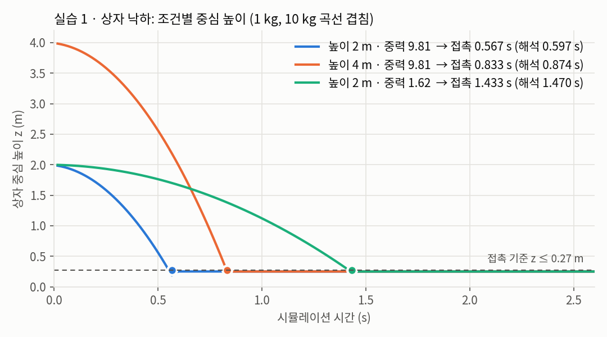
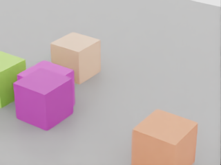
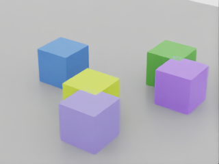
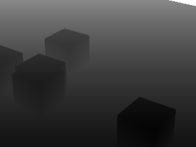
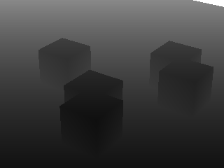
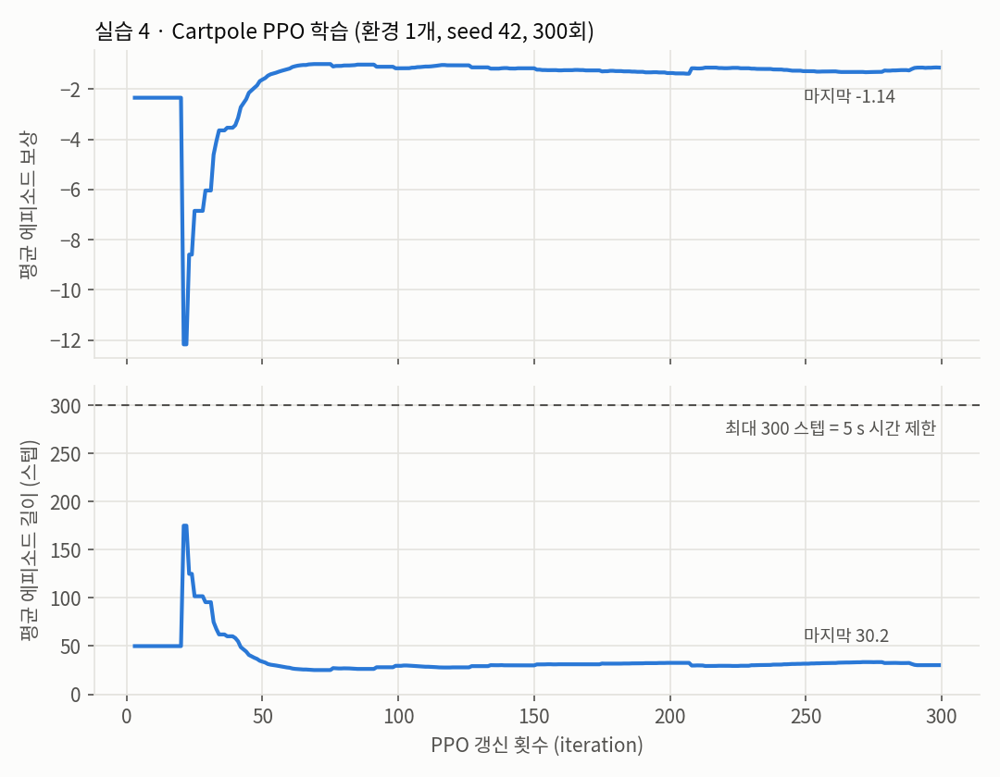

# Isaac Sim 6.1 · Isaac Lab 실습 — 상자 낙하, 카메라, 보상, Cartpole PPO

> 실습일 2026-10-20, 정리일 2026-10-21
> 자료: Isaac Sim·Lab 실습 안내서 (KANT, Isaac Sim 6.1 / Isaac Lab 3.0 EA, 8GB 소형 실습. 로컬 `ref/ROS2/`에만 보관)
> 실습 코드: [SeongminJaden/isaac-sim-lab-practice](https://github.com/SeongminJaden/isaac-sim-lab-practice) (커밋 69c4299, `~/pa-course/windows_lab`에 clone)
> Isaac Sim은 이미 설치된 pip 환경 `~/isaacsim-venv`(6.1) 사용, Isaac Lab은 `~/pa-course/IsaacLab-6.1`(수업 고정 커밋 ae37b028, v3.0.0-EA)
> PC: RTX 5060 Laptop 8GB (공식 최소 16GB 미만), Ubuntu 24.04
> 개념은 [261019 NVIDIA Isaac 생태계와 강화학습](../261019/ROS2.md) 참고

## 실습 구성
| 실습 | 실행할 것 | 남는 결과 |
|---|---|---|
| 1 물리 | 질량이 다른 두 상자 낙하 | USD 장면, 높이 CSV |
| 2 카메라 | seed가 다른 장면 촬영 | RGB, 깊이 NPY, 메타데이터 |
| 3 보상 | 거리·시간·충돌에 따른 점수 계산 | 보상 계산표 |
| 4 강화학습 | Cartpole 무작위 행동 → PPO 학습 → 재생 | 학습 로그, 체크포인트 |

- 실습 3은 Python만 씀 (GPU·Sim 없이 실행 가능). 나머지는 RTX GPU 필요
- headless로 돌려도 Isaac Sim의 NVIDIA GPU 요구는 그대로

## 1. 기본 도구와 실습 자료
```shell
sudo apt update
sudo apt install -y git build-essential cmake python3.12-venv python3-pip pipx
pipx install uv
export PATH="$HOME/.local/bin:$PATH"
uv --version
mkdir -p "$HOME/pa-course"
git clone --depth 1 https://github.com/SeongminJaden/isaac-sim-lab-practice.git "$HOME/pa-course/windows_lab"
cd "$HOME/pa-course/windows_lab"
bash ubuntu/00_check_environment.sh   # GPU RTX 5060 Laptop, 595.99.02, 8151 MiB 출력
python3.12 99_self_check.py           # Ran 16 tests ... OK (CPU·실행기 검사, GPU 실행 증거 아님)
```

- `99_self_check.py`는 예제 코드 컴파일과 보상 계산만 점검함 → PASS여도 Sim 렌더링·물리·Lab 학습이 된다는 뜻은 아님

## 2. Sim 환경 지정과 첫 실행
```shell
# 기존 pip 설치 환경을 예제 실행기가 쓰게 지정한다(새 터미널마다 다시 실행)
export ISAAC_PYTHON="$HOME/isaacsim-venv/bin/python"
"$HOME/isaacsim-venv/bin/isaacsim" isaacsim.exp.compatibility_check   # 8 GB라 VRAM 항목만 FAILED
"$HOME/isaacsim-venv/bin/isaacsim"
```

- 호환성 검사에서 VRAM만 기준 미달로 나왔지만 이후 실습은 모두 실행됨
- 첫 실행은 약관 확인·확장 다운로드·셰이더 준비 때문에 오래 걸림

## 3. 실습 1 · 상자 낙하
- 조건: 한 변 0.5m 상자 두 개(1kg, 10kg)를 중심 높이 2m에서 떨어뜨림. 높이와 중력을 바꿔 비교
- 결과: 시작 장면 `initial_scene.usda`, 물리 시각별 높이 `heights.csv`

```shell
cd "$HOME/pa-course/windows_lab"
bash ubuntu/run_sim.sh 01                    # 높이 2 m, 중력 9.81
bash ubuntu/run_sim.sh 01 --height 4
bash ubuntu/run_sim.sh 01 --gravity 1.62
```

- 접촉 판정: CSV에서 중심 높이 z ≤ 0.27m인 첫 행 (바닥에 닿았을 때 중심은 0.25m)
- 해석값: 중심이 h에서 0.25m까지 자유낙하하는 시간 $t = \sqrt{2(h-0.25)/g}$

| 조건 | 측정 첫 접촉 | 해석값 |
|---|---|---|
| 2m · 9.81 | 0.567s | 0.597s |
| 4m · 9.81 | 0.833s | 0.874s |
| 2m · 1.62 (달 중력) | 1.433s | 1.470s |



- 1kg과 10kg 곡선은 차이 3e-8m 이하로 겹침
- 마지막 중심 높이는 세 조건 모두 0.250m
- 측정값이 해석값보다 0.03~0.04s 빠름 (원인은 확인 안 함)

### 생각해 볼 질문
- 1kg과 10kg의 첫 접촉 시각은?
  - 둘 다 0.567s. 공기 저항이 없으면 낙하 시간은 질량과 무관 ($h = \frac{1}{2}gt^2$에 질량이 없음)
- 높이 4m면 시간이 정확히 2배인가?
  - 아님. 0.833/0.567 ≈ 1.47배
  - 낙하 시간은 낙하 거리의 제곱근에 비례: $\sqrt{3.75/1.75} \approx 1.46$
- 상자가 바닥에 놓여도 중심 z가 0이 아닌 이유는?
  - 위치가 상자 **중심** 좌표라서. 한 변 0.5m → 중심은 바닥 위 0.25m

## 4. 실습 2 · 카메라와 합성 데이터
- seed에 따라 상자 색과 위치가 바뀌는 장면을 320×240 카메라로 촬영
- RGB와 깊이(카메라 이미지 평면까지의 거리)를 함께 저장. VLM 모델은 실행하지 않고 데이터만 만듦

### 예제 코드 수정 2곳
```shell
# [수정 1] examples/02_camera_capture.py 37행
# Isaac Sim 6.1의 CameraSensor는 resolution을 (height, width) 순서로 받는다
#   (설치된 isaacsim.sensors.experimental.rtx/impl/camera_sensor.py 설명: "OpenCV/NumPy 규칙 (height, width)").
# 원래 코드는 (320, 240)을 넘겨 세로 320 × 가로 240 영상이 나왔고, 예제의 크기 검사 (240, 320)에 걸려 저장 직전에 멈췄다.
# 임시 진단: 원본은 그대로 두고 임시 사본에 배열 크기·예외 출력을 넣어 seed 7을 창 없이 1회 실행 →
#   151프레임 모두 RGB·깊이를 받았고 RGB (320, 240, 3) uint8, 오류 "RuntimeError: Unexpected RGB shape: (320, 240, 3)" 확인.
#   해상도만 (240, 320)으로 바꾼 사본으로 seed 7·42 모두 성공한 뒤 원본에 반영(강사에게 구두로 알림).
#   예제는 예외가 나도 app.close()가 프로세스를 끝내 오류가 화면에 안 남고 종료 코드도 0이었다.
sensor = CameraSensor(author, resolution=(240, 320), annotators=["rgb", "distance_to_image_plane"])

# [수정 2] examples/02_camera_capture.py 64~66행
# 원래 미리보기는 0~5 m를 0~255로 그리는데, 이 카메라 위치(3.5, -5.0, 3.5 m)에서 장면 깊이가 5.16~10.36 m라
#   모든 픽셀이 255(흰색)였다. 범위를 5~15 m로 바꿔 5 m=검정, 15 m 이상·비유효값=흰색으로 그린다.
#   분석용 원본 depth_m.npy는 바뀌지 않는다.
near, far = 5.0, 15.0
preview = np.clip(np.nan_to_num(depth, nan=far, posinf=far, neginf=near), near, far)
Image.fromarray((255 * (preview.squeeze() - near) / (far - near)).astype(np.uint8)).save(out / "depth_preview.png")
```

- 영상 크기 표기가 라이브러리마다 다름
  - NumPy·OpenCV 배열: `(height, width)` = (행, 열) → 320×240 영상은 `(240, 320)`
  - "320×240"이라는 말은 보통 가로×세로
  - 메타데이터의 `"resolution": [320, 240]`은 가로×세로로 기록됨

### 실행
```shell
bash ubuntu/run_sim.sh 02 --seed 7           # 위 [수정 1·2] 반영 후 실행
bash ubuntu/run_sim.sh 02 --seed 42
```

| 파일 | 내용 | 확인할 것 |
|---|---|---|
| `rgb.png` | 렌더링한 색 영상 | 상자·바닥이 보이는가 |
| `depth_m.npy` | 깊이 원본 배열 (단위 m) | 분석은 이 파일로 |
| `depth_preview.png` | 보기용 깊이 영상 | 표시 범위 밖은 잘림 |
| `scene_metadata.json` | seed·색·위치·해상도 | 영상과 같은 실행 폴더인가 |
| `scene.usda` | 카메라 포함 장면 | 시점을 바꿔 다시 확인 |

- 5개 파일 모두 생성. RGB 320×240, 깊이 단위 m
- 깊이 범위: seed 7은 5.16~10.36m, seed 42는 5.61~10.36m

| | seed 7 | seed 42 |
|---|---|---|
| RGB |  |  |
| 깊이 (5~15m) |  |  |

- 두 seed 영상 비교: 

### 생각해 볼 질문
- `depth_preview.png`의 0~255 값으로 실제 거리를 바로 계산해도 되나?
  - 안 됨. 표시 범위 밖 값이 잘림
  - 원래 0~5m 설정에서는 장면 전체가 5m보다 멀어 픽셀이 100% 255였음
  - 거리 분석은 `depth_m.npy`로 함
- 합성 데이터의 장점: 색·위치 같은 정답이 메타데이터에 그대로 남음 → 따로 라벨링할 필요 없음

## 5. 실습 3 · 보상 계산
```shell
python3.12 examples/03_reward_design.py
ls outputs
```

$$
r = 2 \times (d_\text{이전} - d_\text{현재}) - 0.01 \times dt + \begin{cases} +10 & \text{도착} \\ -20 & \text{충돌 (도착보다 우선)} \end{cases}
$$

- 가까워지면 +, 멀어지면 −, 시간이 지나면 조금씩 −. 도착·충돌은 한 번에 큰 값
- 예: 0.1s 동안 2m → 1.8m: $2 \times 0.2 - 0.01 \times 0.1 = 0.399$

| 상황 (0.1s 동안) | 보상 |
|---|---|
| 0.2m 접근 | 0.399 |
| 0.2m 후퇴 | −0.401 |
| 정지 | −0.001 |
| 0.2m 접근하며 도착 | 10.399 |
| 0.2m 접근하며 충돌 | −19.601 |

### 생각해 볼 질문 (편법 행동)
- 목표 근처에서 전진·후진을 반복하면 점수가 쌓이나?
  - 아님. 0.2m 접근 + 0.2m 후퇴 = −0.002 (시간 비용만 남음)
  - 거리 항을 "이전 − 현재"의 **차이**로 줘서 왕복하면 상쇄됨
- 도착 후에도 매 스텝 +10을 주면?
  - 목표에 머물기만 해도 스텝마다 약 +10씩 쌓임 → 끝내지 않고 머무는 행동이 유리해짐
  - 그래서 도착하면 에피소드를 끝내야 함
- 충돌 벌점을 −20에서 −0.1로 줄이면?
  - 0.2m 접근하며 충돌해도 $0.4 - 0.001 - 0.1 = +0.299$로 양수
  - 충돌을 무릅쓰고 돌진하는 편법이 생김
- 시간 비용이 없으면? 정지해도 0점이라 서두를 이유가 없음

## 6. 실습 4 · Isaac Lab Cartpole PPO
```shell
bash ubuntu/04_cartpole.sh --mode list
# → 실패: "isaaclab: error: unrecognized arguments: list_envs --show_presets"
#   수업 고정 커밋의 isaaclab CLI에는 list_envs 하위 명령이 없다(train, play, random_agent, zero_agent 등만 있음).
#   대신 Lab 폴더의 스크립트로 확인 → Isaac-Cartpole(physics 프리셋 isaacsim_physx 포함) 등록 확인
cd "$HOME/pa-course/IsaacLab-6.1" && uv run --frozen --extra isaacsim python scripts/environments/list_envs.py --keyword Cartpole --show_presets
cd "$HOME/pa-course/windows_lab"
bash ubuntu/04_cartpole.sh --mode random
bash ubuntu/04_cartpole.sh --mode train --num-envs 1 --iterations 300
bash ubuntu/04_cartpole.sh --mode play --checkpoint latest   # while True 반복 재생이라 Ctrl+C로 종료
```

- 순서: 무작위 행동(학습 전) → PPO 학습 → 학습한 정책 재생
- 학습 기록: `~/pa-course/IsaacLab-6.1/logs/rsl_rl/cartpole/2026-10-20_12-31-29/` (model_0 ~ model_299, 50회마다 저장)
- play는 같은 폴더의 model_299를 불러 `exported/policy.pt`, `policy.onnx`도 만듦
  - `latest`는 호환되는 최근 실행을 고름 → 실제로 불러온 경로를 따로 확인해야 함

### Isaac-Cartpole 과제 구성
> 근거: Lab 소스 `cartpole_manager_env_cfg.py`, 실행 폴더의 `params/env.yaml`·`agent.yaml`

| 구분 | 내용 |
|---|---|
| 관측 | 4개: 카트 위치·속도, 막대 각도·각속도 (기본 자세 대비 상대값, 잡음 없음) |
| 행동 | 1개: 카트 관절(`slider_to_cart`)에 가하는 힘. 정책 출력 × 100 |
| 보상 | 생존 +1.0 / 종료 −2.0 / 막대 각도² × (−1.0) / 카트 속도 절댓값 × (−0.01) / 막대 각속도 절댓값 × (−0.005) |
| 종료 | 시간 제한 5s(300스텝), 카트 위치 ±3m 벗어남. **막대가 쓰러지는 것만으로는 종료 안 함** |
| 초기화 | 카트 위치 ±1.0m·속도 ±0.5m/s, 막대 각도 ±45°·각속도 ±0.25π rad/s 범위에서 무작위 |
| 환경 | 물리 `isaacsim_physx`, 시뮬레이션 1/120s, decimation 2 → 제어 60Hz. 환경 1개 (과제 기본값은 4096개) |

- 보상을 [261019](../261019/ROS2.md)의 용어로 보면
  - 생존 +1: 오래 버틸수록 좋음 / 종료 −2: 카트가 범위를 벗어나면 벌점
  - 막대 각도²: 막대가 똑바로 설수록 벌점이 작음 (제곱이라 많이 기울수록 크게 깎임)
  - 속도 항: 카트·막대가 덜 흔들리게
- decimation: 물리는 1/120s마다 계산하고, 정책은 2번에 한 번 행동을 냄 → 제어 주기 60Hz
  - Sim to Real의 "제어 주기 확인"과 연결되는 값

### PPO 설정 (rsl_rl OnPolicyRunner)
| 항목 | 값 |
|---|---|
| 신경망 | actor·critic 모두 MLP [32, 32], ELU |
| 정책 | 가우시안, 초기 표준편차 1.0 |
| 수집·갱신 | 환경당 16스텝 수집 → 5 epoch × 미니배치 4 |
| 학습률 | 1e-3 (adaptive, desired_kl 0.01) |
| 할인·GAE | γ 0.99, λ 0.95 |
| clip / entropy | 0.2 / 0.005 |
| 반복 | 300회, seed 42 |

- clip 0.2: 261019에 정리한 PPO 식의 $\epsilon$. 한 번 갱신에 행동 확률 비를 0.8~1.2 밖으로 크게 바꾸지 않음
- γ: 먼 미래 보상을 얼마나 깎아서 볼지 / λ: advantage 추정에서 편향과 분산의 균형
- entropy: 행동을 너무 일찍 하나로 굳히지 않게 탐색을 유지하는 항

### 학습 결과


- 전체 수집: 4,800스텝 (16 × 환경 1개 × 300회, 시뮬레이션 80s 분량)
- 마지막 평균 보상 −1.14 (최고 −1.01)
- 마지막 평균 에피소드 길이 30.2스텝 ≈ 0.5s (최대 300)
- 마지막 50회의 종료 원인은 모두 카트 범위 이탈, 시간 제한 종료 0
- 정책 표준편차는 약 0.93으로 초기값 1.0 근처에 머묾
- 정리: 보상이 초반보다 오르긴 했지만 **균형을 배운 것은 아님**
  - 에피소드가 0.5s 만에 카트 범위 이탈로 끝남
  - 학습한 경험이 4,800스텝뿐 (과제 기본값 4096개 환경이면 1회 갱신에 약 65,000스텝)
  - 표준편차가 거의 줄지 않음 → 행동이 아직 무작위에 가까움
- 보상 상승만 보고 성공이라 판단하면 안 됨 → 에피소드 길이·종료 원인을 같이 봐야 함

## 실습 자료에서 발견한 문제
- 카메라 해상도 순서가 반대 → [수정 1]
- 깊이 미리보기 범위(0~5m)가 이 카메라 위치에 안 맞아 전부 흰색 → [수정 2]
- `isaaclab list_envs` 하위 명령이 수업 고정 커밋에 없음 → `scripts/environments/list_envs.py`로 대체
- 예제에서 예외가 나도 종료 코드가 0이고 오류 메시지가 남지 않음 → 실패가 성공처럼 보임
  - 종료 코드만 믿지 말고 결과 파일이 실제로 생겼는지 확인
