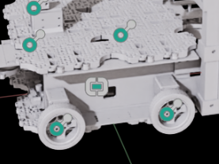
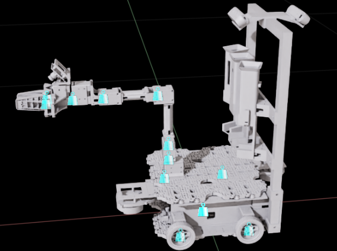
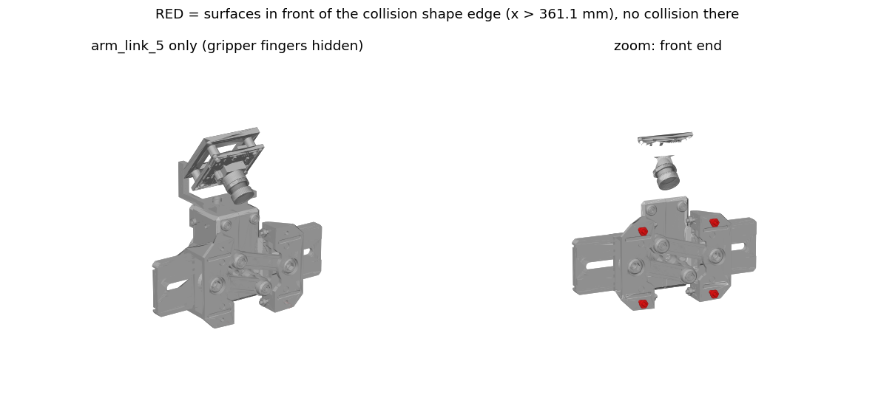
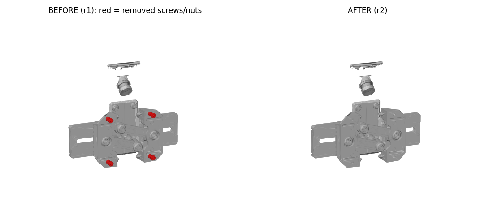

# Waffle 4WD 로봇 모델(URDF·USD) 확인과 261022 리비전

> 작업일·정리일 2026-10-22. Isaac Sim 화면 확인은 직접 했고, 나머지는 모두 파일 계산(모의·정적 검사). 물리 재생(Play)은 안 함
> 학습자료: CAD에서 URDF·USD 만들기 (KANT, 로컬 `ref/ROS2/`에만 보관), [URDF·USD → MuJoCo 코드 실습 (velog)](https://velog.io/@roboticsmaster/2026-10-22-URDFUSD-Mujoco)
> 작업 위치 `~/git/lv2_next_module/` (아래 상대 경로는 이 폴더 기준). 이전: [261021 Waffle 4WD URDF → USD](../261021/ROS2.md)

> **경로 변경 (같은 날 오후)**: 아래 7~9장 명령은 실행 당시 경로 그대로임. 이후 261022 리비전을 옮기고 패키지 이름을 바꿨음
> - URDF `mine/urdf/waffle_4wd_description_261022/` → `261022_1243/urdf/waffle_4wd_description_261022/`
> - 패키지 이름 `waffle_4wd_description_261021` → `waffle_4wd_description_261022` (package.xml, CMakeLists, URDF `package://` 504곳, launch)
> - USD `sim/isaac/usd/waffle_4wd_261022/` → `261022_1243/usd/waffle_4wd_261022/`
> - `sim_ws/src`에는 `waffle_4wd_description_261021`(원본)과 `waffle_4wd_description_261022`(새 경로) 링크가 둘 다 있음
> - 다시 실행할 때는 새 경로를 씀. `import_waffle_4wd.py`는 이제 패키지 이름을 `package.xml`에서 읽음 (`--package-name` 고정 기본값 제거)

- 흐름: Isaac Sim 화면 확인 → 이상해 보이는 표시 분석 → Colliders GPU 크래시 대응 → 단위·축 확인 → 충돌 형상 수치 검사(C1~C3) → arm_link_5에 잘못 들어간 집게 나사 제거(261022 리비전) → USD 재생성·재검사 → 이전 리비전 사용처 교체
- 강의 기준으로 보면 오늘은 전부 **정적 검사**: 파일과 모델의 일관성 확인. 조건별 수치·제한을 보는 주행 검사는 다음 단계

## 1. Isaac Sim 화면 확인
```shell
~/isaacsim-venv/bin/isaacsim
# File > Open: ~/git/lv2_next_module/sim/isaac/usd/waffle_4wd_r1/waffle_4wd/waffle_4wd.usda
# Stage에서 waffle_4wd 선택 > Property > Variants > Physics = physx
#   (USD의 Physics variant 기본 선택이 비어 있어서, 안 고르면 질량·관절 없이 모양만 열린다)
# 뷰포트 표시 메뉴(눈 모양) > Show By Type > Physics > Joints / Mass Properties
```

- variant: 한 USD 안에 여러 버전을 넣어 두고 골라 쓰는 기능 → 이 USD는 물리 설정을 Physics variant로 골라야 붙음 (파일 구성은 [261021](../261021/ROS2.md#이번-usd의-파일-구성))
- 결과: 외형 같음, 관절 표시는 모두 제자리. 다만 footprint 위치에 관절 표시 1개와 질량 표시 1개가 보임

| 관절 표시 | 질량 표시 |
|---|---|
|  |  |

## 2. footprint 위치의 표시는 무엇인가
- pxr(USD Python API)로 관절 프레임과 질량 중심 위치를 계산

```shell
~/isaacsim-venv/bin/python -I - <<'EOF'
from pxr import Usd, UsdGeom, UsdPhysics, Gf
s = Usd.Stage.Open('sim/isaac/usd/waffle_4wd_r1/waffle_4wd/waffle_4wd.usda')
r = s.GetDefaultPrim()
with Usd.EditContext(s, s.GetSessionLayer()):          # 파일은 바꾸지 않고 세션에서만 variant 선택
    r.GetVariantSets().GetVariantSet('Physics').SetVariantSelection('physx')
c = UsdGeom.XformCache()
for p in Usd.PrimRange(r):
    if p.IsA(UsdPhysics.Joint):                        # 관절 프레임 = body0 좌표의 localPos0
        b0 = p.GetRelationship('physics:body0').GetTargets()[0]
        pos = c.GetLocalToWorldTransform(s.GetPrimAtPath(b0)).Transform(Gf.Vec3d(p.GetAttribute('physics:localPos0').Get()))
        print(p.GetName(), pos)
EOF
```

- 세션 레이어: 메모리에만 있는 맨 위 레이어 → 여기서 variant를 고르면 파일은 안 바뀜
- URDF와 USD의 관절 표기 (강의)

| 항목 | URDF | USD |
|---|---|---|
| 연결 | parent / child | body0 / body1 |
| 관절 위치 | origin | localPos0 / localPos1 |
| 축 방향 | axis + origin rpy | axis + localRot0/1 |
| 회전 한계 | radian (90° = 1.5707963) | degree (90.0) |

- 그래서 관절의 월드 위치 = body0(부모) 링크의 월드 변환 × localPos0
- 결과
  - `lidar_front_fixed`, `lidar_rear_fixed` 두 관절이 모두 (0, 0, 0.0067m) = base_link 원점에 있음
  - URDF에서 이 관절 원점이 `0 0 0`이고, 라이다 실제 위치(±0.1855m)는 그 아래 `lidar_*_scan_fixed`에 있음
  - 고정 관절이라 물리 영향 없음 → **문제없음**
- 질량 중심 14개 중 footprint 근처에 있는 것은 없음 (라이다 CoM은 (±0.175, ±0.049, 0.084m))
  - 화면의 질량 표시는 라이다 링크 원점일 가능성이 큼. 질량 값 자체는 URDF와 일치 (아래 2단계 판정 ④)

## 3. Colliders 표시 → GPU 크래시와 설정 되돌리기
- Colliders 표시를 All로 켜자 GPU 크래시, 그 설정이 저장돼 다음 실행이 멈춤

```shell
grep -n -iE "error|crash|device_lost" "$HOME/.nvidia-omniverse/logs/Kit/Isaac-Sim Full/6.1/kit_20261022_090644.log" | tail
# → [omni.rtx] GPU crash is detected ... VkResult: ERROR_DEVICE_LOST
#   (원인 후보: 장치 손실·메모리 부족·버그. 확정 못함. GPU 8 GB)
grep -o '"visualizationDisplay[A-Za-z]*": *[0-9a-z]*' "$HOME/.local/share/ov/data/Kit/Isaac-Sim Full/6.1/user.config.json"
# → visualizationDisplayColliders: 2 (All)가 저장돼 있어 다음 실행이 무한 응답 없음
```

수정한 값: `/persistent/physics/visualizationDisplayColliders` 2(All) → **0(None)** (Isaac Sim이 꺼진 상태에서, 백업 후 수정)

```shell
python3 - "$HOME/.local/share/ov/data/Kit/Isaac-Sim Full/6.1/user.config.json" <<'EOF'
import json, sys
p = sys.argv[1]; d = json.load(open(p))
d['persistent']['physics']['visualizationDisplayColliders'] = 0   # 2(All) → 0(None)
json.dump(d, open(p, 'w'), indent=4)
EOF
```

- `persistent` 설정은 Isaac Sim을 껐다 켜도 남음 → 크래시를 부른 설정이 다음 실행까지 따라옴
  - 로그로 원인을 찾고, 프로그램을 끈 상태에서 백업 후 고쳐야 함
- 이 로봇은 충돌 형상이 542개라 All로 한꺼번에 그리기엔 8GB GPU에 부담이 컸을 가능성 (원인 확정은 못함)
- 교훈: 충돌 형상은 Colliders를 **Selected**로 두고 링크 하나씩 보거나, 아래 5장처럼 수치로 확인

## 4. 단위·축 확인 (mm인 줄 알았던 것)
```shell
grep -o 'scale="[^"]*"' mine/urdf/waffle_4wd_description_261021/urdf/waffle_4wd.urdf | sort | uniq -c
# → 504 scale="1 1 1"
grep -ho '<unit[^>]*>' mine/urdf/waffle_4wd_description_261021/meshes/main/*.dae | sort | uniq -c
# → 14 <unit name="meter" meter="1.0"/>   (up_axis Z_UP)
```

- 강의: CAD는 보통 mm → URDF·USD는 m로 통일 (1,000으로 나누기). 메시 좌표가 mm면 `scale="0.001 0.001 0.001"`, 이미 m면 1
- 이 로봇은 CAD(Fusion)에서 mm로 작업했지만 **내보낸 URDF는 이미 m**
  - STL 꼭짓점 값도 m 범위 (예: −0.0921~0.29), USD `metersPerUnit` 1
  - 변환한 것 없음, 변환 필요 없음. 메시 배율 1이 맞음
- 단위가 틀리면 보통 크기가 1,000배 차이 → 강의의 "오류를 좁히는 순서"에서 첫 번째로 mm→m, mesh scale, stage 단위를 봄
- 축: ROS REP-103(x 앞·y 왼쪽·z 위) 그대로
  - 앞 라이다·팔이 +x, Front_Left 바퀴 y = +0.1396m, 바퀴 중심 z = 0.033m
  - 강의 예제는 CAD 축이 달라 회전 행렬 $C$로 바꿔야 했지만($v_\text{local} = C \cdot v_\text{CAD,mm}/1000 - \text{origin}_m$), 이 로봇은 필요 없음
- 변환이 필요한 곳은 따로 있음
  - Isaac 카메라: USD 카메라는 −Z가 시선 ([261021](../261021/ROS2.md#카메라가-아래를-보는-것처럼-보였던-이유)의 ROS 광학 프레임은 +Z가 시선)
  - 관절 각도: USD는 degree, ROS는 rad

| 질문 | 답 |
|---|---|
| 차체+바퀴 크기 | 0.371 × 0.305 × 0.513m (가로·세로 600mm 이내) |
| 라이다 포함 길이 | 0.4445m |
| 관절 0 자세(팔을 앞으로 편 상태) 전체 길이 | 0.652m (팔 접은 기준 600mm라 문제없음) |

## 5. 충돌 형상 수치 검사 C1~C3
- 강의: visual은 화면에 보이는 메시, collision은 접촉 계산용 단순 형상 → 둘이 너무 다르면 보이는 것과 다르게 부딪힘
- Colliders 화면 확인 대신 수치로 판정

| 검사 | 판정 기준 |
|---|---|
| C1 | 링크마다 충돌 형상 범위와 표시 메시 범위 차이가 축마다 ≤ 5mm |
| C2 | convex hull 부피 ÷ 메시 부피 ≤ 1.01 |
| C3 | 관절 0 자세에서 관절로 직접 붙지 않은 링크끼리 겹침 0쌍 (볼록 형상 교집합의 내접 구 반지름을 선형계획으로 계산) |

```shell
~/isaacsim-venv/bin/python -I sim/isaac/check_colliders_waffle_4wd.py \
    --usd sim/isaac/usd/waffle_4wd_r1/waffle_4wd/waffle_4wd.usda \
    --json sim/isaac/logs/check_colliders_r1.json
```

- C2를 보는 이유: PhysX는 충돌 메시를 convex hull(볼록 껍질)로 감싸서 계산 → 오목한 메시면 실제보다 부풀어 일찍 부딪힘
- C3 계산: 두 볼록 형상이 겹치면 교집합 안에 구가 들어감 → 그 구의 최대 반지름이 0보다 크면 겹침
  - 볼록 형상은 평면 부등식 $a_i \cdot x \le b_i$의 묶음이라 "모든 면에서 거리 $r$ 이상 떨어진 점 $x$ 중 $r$ 최대"가 선형계획 문제가 됨

| 검사 | 원본(261021) 결과 |
|---|---|
| C1 | **실패 1건**: 13링크는 0.0mm, `arm_link_5`만 앞쪽 5.5mm (충돌 끝 0.3611m, 표시 끝 0.3666m) |
| C2 | 성공: 메시 490개 모두 닫힘, 부피 비 최대 1.000003 (이미 볼록 조각이라 PhysX convex hull로 부풀지 않음) |
| C3 | 성공: 겹침 0쌍. 관절 0 자세에서 집게 왼쪽·오른쪽이 아주 가까움 (닫힘 한계 −1.4mm까지 가면 닿을 수 있음 → 3단계) |

## 6. arm_link_5 원인 조사 — 집게 나사가 손목 메시에 들어가 있었음
- 처음엔 범위만 보고 "4mm 얇은 판"이라 설명했는데 틀림. 음영 그림으로 보니 앞판 네 모서리의 작은 육각 머리였음
- 실물 arm_link_5에는 볼트·너트가 없음 (직접 확인) → 집게 쪽 나사
- 메시를 연결 조각으로 나눠 확인
  - `arm_link_5.dae`는 메시 1개 (점 63,696, 삼각형 123,499)
  - 같은 좌표의 점을 하나로 보면 조각 207개
  - 나사 축 4곳마다 나사 1조각(삼각형 587) + 너트 1조각(594) = **8조각, 삼각형 4,724개**
  - 집게 메시 표면에서 거리 중앙값 0.6mm
- 강의: CAD 부품은 서로 고정된 것끼리 같은 링크로 묶고, **모든 CAD 바디가 정확히 한 링크에 속해야 함**
  - 집게에 붙어 움직여야 할 나사가 손목 링크로 잘못 묶인 경우
- 그대로 두면 집게를 열고 닫아도 나사가 손목에 남아 떠 보임 (카메라 영상·YOLO 데이터에 찍힐 수 있음)
  - 표시 전용 메시라 충돌·질량·관절과는 무관



## 7. 261022 리비전 만들기 (나사 삭제)
```shell
cd ~/git/lv2_next_module/mine/urdf
cp -a waffle_4wd_description_261021 waffle_4wd_description_261022     # 원본 보존, 패키지 이름은 그대로 waffle_4wd_description_261021
cd ~/git/lv2_next_module
~/isaacsim-venv/bin/python -I sim/tools/remove_arm_link_5_fasteners.py \
    mine/urdf/waffle_4wd_description_261021/meshes/main/arm_link_5.dae \
    mine/urdf/waffle_4wd_description_261022/meshes/main/arm_link_5.dae
# → 조각 207개 중 지울 조각 8개, 삼각형 4724개
#   점 63696→61116, 법선 116639→112003, 삼각형 123499→118775
#   (조각 8개·삼각형 4724개가 아니면 파일을 쓰지 않게 해 둠. 쓰지 않는 점도 빼야 범위 계산에 안 남는다)
```

- 원본(261021)은 그대로 두고 복사본에서 수정 → 문제가 생기면 비교·되돌리기 가능
- 스크립트는 예상한 개수(8조각, 4,724삼각형)와 다르면 파일을 안 씀 → 엉뚱한 조각을 지우는 사고 방지
- 기록: `mine/urdf/waffle_4wd_description_261022/REVISION_261022.md`



## 8. USD 재생성과 재검사
```shell
R=mine/urdf/waffle_4wd_description_261022
~/isaacsim-venv/bin/python sim/isaac/import_waffle_4wd.py --urdf $R/urdf/waffle_4wd.urdf --package-dir $R \
    --out sim/isaac/usd/waffle_4wd_261022 --/crashreporter/url=
~/isaacsim-venv/bin/python -I sim/isaac/check_usd_waffle_4wd.py --urdf $R/urdf/waffle_4wd.urdf \
    --usd sim/isaac/usd/waffle_4wd_261022/waffle_4wd/waffle_4wd.usda
~/isaacsim-venv/bin/python -I sim/isaac/check_colliders_waffle_4wd.py \
    --usd sim/isaac/usd/waffle_4wd_261022/waffle_4wd/waffle_4wd.usda
```

- importer 오류 0 (강성·감쇠 경고 11줄은 이전과 같음)
- 이전 USD와 비교: 바뀐 파일은 메시가 든 `geometries.usd`와 `base.usda`의 설명 문자열뿐. Physics 레이어(질량·관절·충돌)는 바이트까지 같음
  - 레이어를 나눠 둔 덕분에 표시 메시만 바뀌었다는 것을 파일 단위로 확인 가능

### 2단계 판정 ②~⑩ (USD를 새 프로세스에서 다시 열어 URDF 값과 비교)
| 번호 | 항목 | 결과 |
|---|---|---|
| ② | 다시 열기 (합성 오류, 참조 파일, 기본 variant) | 성공 |
| ③ | 단위·축 | 성공 |
| ④ | 질량·질량중심·주관성 모멘트 | 성공 |
| ⑤ | 관절 | 조건부 (속도 한계가 Newton 속성으로만 적혀 있음) |
| ⑥ | mimic | 성공 |
| ⑦ | 프레임 자세 (관절 0 자세, root 링크 기준) | 성공 |
| ⑧ | 충돌 형상 | 성공 |
| ⑨ | 표시 메시 | 성공 |
| ⑩ | 자기충돌 | 조건부 (Newton 속성으로만 적혀 있음) |

- ⑤·⑩의 PhysX 적용은 3단계에서 확인
- C1~C3: **전체 성공** (C1 arm_link_5 5.5mm → 0mm)
- 강의의 정적 검사 기준(구조, 메시·수치에 NaN·Inf 없음, 물성, 형식 간 질량·원점·축·연결 일치, 독립 FK)과 같은 생각: 두 형식이 같은 로봇을 표현하는지 먼저 확인하고 나서 주행

## 9. 이전 리비전 사용처 교체
```shell
cd ~/git/lv2_next_module/sim_ws
ln -sfn ~/git/lv2_next_module/mine/urdf/waffle_4wd_description_261022 src/waffle_4wd_description_261021   # 링크 대상만 261022로
source /opt/ros/lyrical/setup.bash
colcon build
source install/setup.bash
check_urdf $(ros2 pkg prefix waffle_4wd_description_261021)/share/waffle_4wd_description_261021/urdf/waffle_4wd.urdf
```

- 패키지 이름(`waffle_4wd_description_261021`)은 그대로 두고 심볼릭 링크 대상만 바꿈 → launch 파일·`package://` 경로를 안 고쳐도 됨
  - 오후에 패키지 이름도 `waffle_4wd_description_261022`로 바꿔 두 리비전을 따로 둠 (맨 위 경로 변경 참고)
    - 이름이 같으면 두 리비전을 한 작업 공간에 같이 둘 수 없고, 어느 쪽이 빌드됐는지 헷갈림
- 빌드 성공, 설치된 `arm_link_5.dae` 해시가 261022와 같음, check_urdf 성공
- 인수인계 묶음: `urdf_261022.zip`, `waffle_4wd_usd_261022.zip`을 새로 만들고 문서의 경로·해시를 고침
- 문제: 원본 `urdf.zip`을 풀면 `urdf/` 폴더가 **쓰기 금지 권한**으로 만들어져서 새 리비전을 같은 폴더에 풀 수 없었음
  - 새 zip은 최상위 폴더를 `urdf_261022/`로 분리
  - 임시 폴더에서 문서 순서대로 압축 해제 → 링크 → check_urdf → colcon build → C1~C3까지 성공 확인

---

# CAD에서 URDF·USD 만들기 — 모델 생성과 주행 검증

> 학습일 2026-10-22, 정리일 2026-11-02. 자료: CAD에서 URDF·USD 만들기 (KANT, 로컬 `ref/ROS2/`에만 보관)
> 실습: [URDF_USD_IsaacSim62_v4](https://github.com/SeongminJaden/URDF_USD_IsaacSim62_v4), [URDF·USD → MuJoCo 코드 실습 (velog)](https://velog.io/@roboticsmaster/2026-10-22-URDFUSD-Mujoco). 실행 결과는 이 TIL에 기록하지 않음

## 수업 범위
- 목표: CAD 부품을 링크·관절로 나누고, **같은 파라미터**로 URDF와 USD를 만들고, 정적 검사와 주행 검증을 구분
- 교안 사례 M38: 링크 9·구동 관절 8(조향 4 + 바퀴 4), 팔은 CAD 자세로 고정, 평지·저속·총질량 4kg 가정

| 형식·엔진 | 역할 | 확인 대상 |
|---|---|---|
| URDF | 링크·관절 기술 | 트리, 좌표, 관성, 메시 |
| USD | 장면과 물리 속성 | RigidBody, Mass, Joint |
| MuJoCo / Isaac PhysX | 동역학 계산 | 시험 모델 / 실제 USD의 주행 |

## 모델 만들기
- 링크 묶기: 서로 고정된 부품은 한 링크, 움직이는 경계에 관절, **모든 CAD 바디는 정확히 한 링크에** (위 6장의 나사가 어긴 예)
- 단위·좌표: mm → m(÷1000), ROS 기준 x 앞·y 왼쪽·z 위
  - $v_\text{local} = C \cdot v_\text{CAD,mm}/1000 - \text{origin}_m$ (예: [100, 200, 30]mm → [0.2, −0.1, 0.03]m)
  - Waffle 4WD는 내보낸 URDF가 이미 m·REP-103이라 필요 없었음 (위 4장)
- 관절: `origin` = 부모에서 본 관절 위치·방향, `axis` = 회전 방향. 거울 배치된 오른쪽 모듈은 축 부호 확인 (0, ±0.3rad로 돌려 봄)
  - `fixed`는 axis·limit 없음, `continuous`는 lower·upper 없음
  - 부모·자식은 **이름**으로 연결 → 이름 오타는 XML 문법은 통과해도 트리가 깨짐
- 링크 = `<inertial>` + `<visual>`(보이는 메시) + `<collision>`(접촉용 단순 형상, 바퀴는 원통·부품은 박스)
- 균질 상자 관성: $I_{xx} = \frac{m}{12}(y^2+z^2)$ 등 (예: $m=12$, [1, 2, 3] → [13, 10, 5]). CAD 관성을 이 식으로 대체하지 않음

## USD 물리 모델
| 대상 | 필요한 설정 |
|---|---|
| Stage | `metersPerUnit=1`, `upAxis=Z` |
| /Robot | defaultPrim, `ArticulationRootAPI` |
| 링크 / 충돌 도형 | `RigidBodyAPI`, `MassAPI` / `CollisionAPI` |
| 관절 | `RevoluteJoint` + body0/body1 |
| 장면 | `PhysicsScene`, 바닥은 시험에 맞게 추가 |

- URDF↔USD 관절 표기는 위 [2장](#2-footprint-위치의-표시는-무엇인가) 표 (USD 회전 한계는 degree)
- 실습: JSON(로봇별 데이터)과 Python(절차)을 나눔. `units=SI`라고 적어도 자동 변환은 없음 → 400mm는 0.4, 90°는 1.570796으로 직접 입력
  - 값 바꿔 재생성: 질량 0.2 → 0.3이면 두 형식이 함께, origin z 0.1 → 0.12면 URDF `origin`과 USD `localPos0`가 함께 바뀌어야 함
  - 일부러 USD 한계를 rad로 넣은 오류 모델이 `angle unit mismatch`로 **FAIL하는지**도 봐야 검사기를 믿을 수 있음

```shell
.venv/bin/python code/build_robot.py examples/robot.json output/robot.urdf
.venv/bin/python code/inspect_robot.py output/robot.urdf --out output/check
"$HOME/isaacsim/python.sh" code/convert_urdf62.py output/robot.urdf output/slider-usd-run1 --base fixed
```

## 정적 검사와 주행 검사
- 정적 검사 기준: 구조(링크·관절 수, root), 메시 경로·NaN·Inf, 총질량·관성, 형식 간 질량·원점·축·연결 일치, 독립 FK(0, ±0.3rad)
- `PASS_STATIC`은 파일 일관성일 뿐 **주행 성공이 아님**
- 주행: MuJoCo 마찰 0.3/0.6/0.9 × 전진·횡이동·대각선·회전 12조건, Isaac에서는 DOF **이름**으로 관절 매핑, drive gain 0 + effort 제어
- Isaac 합격 기준(교안): 위치 < 0.05m, yaw < 5°, 조향 각속도 ≤ 1.001rad/s, 최종 토크 ≤ 1.000001N·m, 수치 유한
- 도착해도 FAIL (교안 기록): 대각선은 위치 오차 4.349mm로 도착했지만 최대 조향 속도 1.0142rad/s로 한계 초과 → 다음 실험은 조향 목표 변화율을 줄이고 재시험
  - 판정은 도착 여부와 **과정 중 제한 준수**를 따로 봄
- 매 물리 스텝 기록: 렌더 간격으로만 저장하면 순간 최고 속도를 놓침. 빈 목록·NaN은 실패 (Python `all([])`은 True라 데이터 존재를 따로 확인)

## 오류를 좁히는 순서
| 증상 | 먼저 확인할 것 |
|---|---|
| 크기가 1,000배 차이 | mm→m, mesh scale, stage 단위 |
| 회전 방향이 반대 | joint axis, 좌우 모듈 부호 |
| 관절이 다른 부위를 움직임 | body0/1, DOF 이름 매핑 |
| 기록은 정상인데 순간 초과 | 다운샘플 전 모든 스텝의 최대값 |
